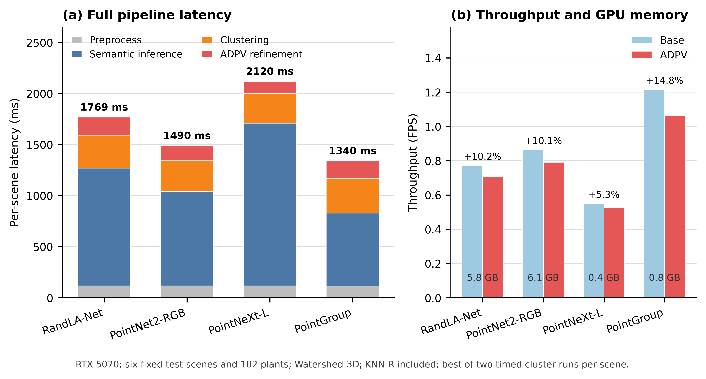
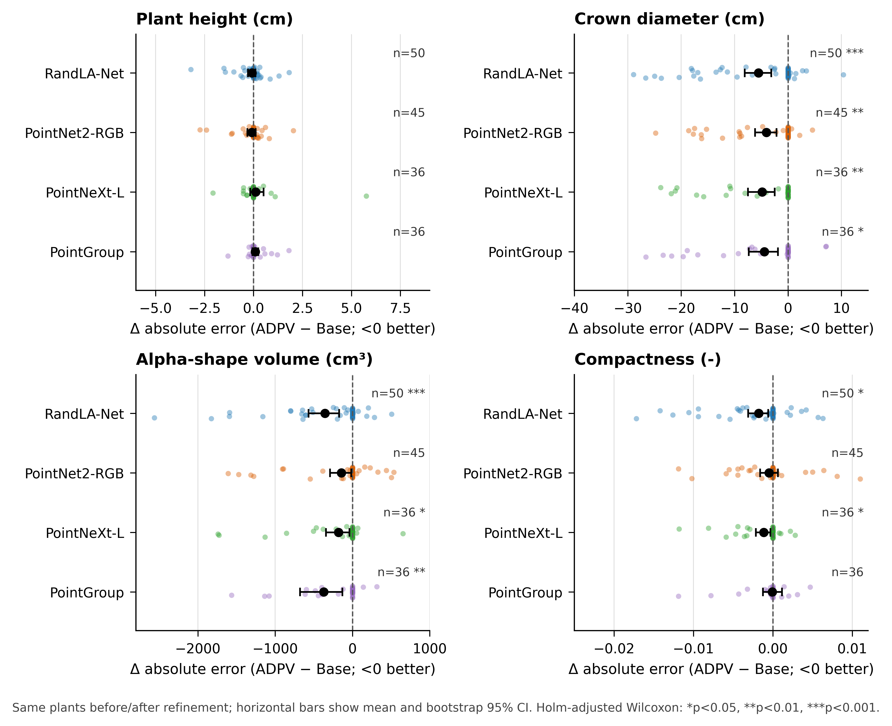
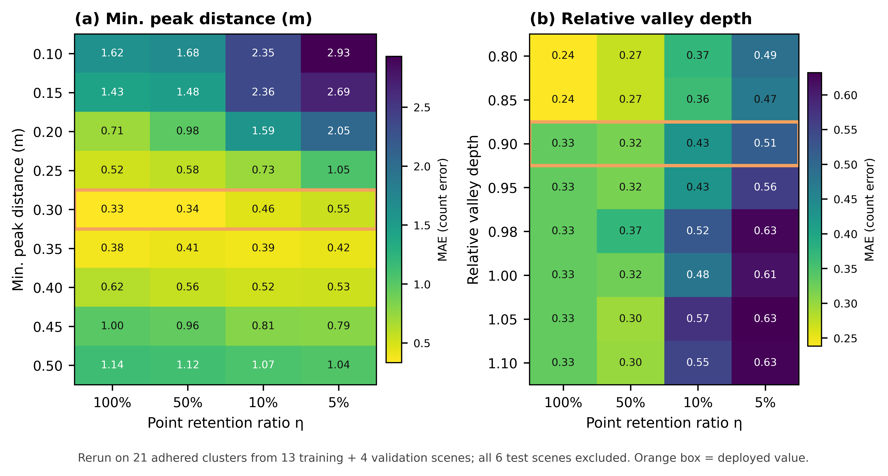

# COMPAG-D-26-10878 修回实验复核结果

> 前稿编号：**COMPAG-D-26-10878**  
> 复核日期：2026-11-11（主实验）；2026-11-12（HDBSCAN 补充）  
> 数据口径：固定 23 场景 / 365 株，划分为 13/4/6（203/60/102 株）。  
> 测试场景：cloudR2、cloudR5、cloudR9、cloudR12、cloudR14、cloudR18。

## 0. 本次最终模型口径

本文件采用混合 checkpoint 口径：

| 模型 | 使用的 checkpoint | 说明 |
|---|---|---|
| RandLA-Net | `revision_data/runs/ransac_retrain_20261111/randlanet/best.pth` | RANSAC 非地面数据重训，按验证 mIoU 选择 |
| PointNet2-RGB | 原 v6 checkpoint | 未重训，保留原结果 |
| PointNeXt-L | `revision_data/runs/ransac_retrain_20261111/pointnext_final/best.pth` | RANSAC 非地面数据重训，按验证 mIoU 选择 |
| PointGroup | 原 v6 checkpoint | 未采用 RANSAC 重训版本；重训版本未优于旧模型 |

所有方法仍使用同一 6 个测试场景、同一 102 株 GT、同一 RANSAC 输入和同一评价代码。

## 1. 编辑意见与修改对应

| 编辑意见 | 本次修改 | 可核查材料 |
|---|---|---|
| 测试场景和植株样本前后不一致 | 固定 6 个测试场景、102 株；所有方法使用同一测试队列 | `test_plant_registry.csv`、`scene_plant_counts.csv` |
| 无法核查场景到植株的映射 | 提供场景—植株—方法—指标逐层表 | `main_unified_20261112/scene_plant_method_metrics.csv` |
| 性状比较前后不是同一批植株 | 使用完全相同的 `(scene_id, plant_id, gt_instance_id)` 做 Base/ADPV 配对；报告 bootstrap 95% CI 和 Holm 校正 | `paired_rerun_20261111/v6_paired_trait_statistics.csv`、`v6_paired_trait_deltas.csv` |
| 需要说明数据划分和防止泄漏 | 固定 13/4/6 划分；训练、验证、测试场景不重叠；测试集只做最终评价 | `paper_split_v2.json`、`Table_S1_Scene_Split.csv` |
| 新投稿及 cover letter 要求 | 保留前稿编号，并逐条说明测试队列和配对性状修改 | 本文第 7 节 |

## 2. 固定测试队列

| 测试场景 | 植株数 |
|---|---:|
| cloudR12 | 30 |
| cloudR14 | 19 |
| cloudR18 | 16 |
| cloudR2 | 8 |
| cloudR5 | 9 |
| cloudR9 | 20 |
| **合计** | **102** |

完整测试植株 registry、逐株 ID 和场景划分见 `revision_data/splits/`。

## 3. 固定测试集主结果

coverage 为成功匹配的测试植株数占 102 的比例；P、R、F1 和 mIoU 按 6 个测试场景宏平均。`Instance mIoU` 与 `Semantic mIoU` 分开报告，不能混用。

| 模型 | 聚类 | 配置 | P | R | F1 | Instance mIoU | Semantic mIoU | Coverage | MAE-count |
|---|---|---|---:|---:|---:|---:|---:|---:|---:|
| PointGroup | HDBSCAN | ADPV | 0.8620 | 0.7681 | 0.7967 | 0.7406 | 0.7195 | 67.6% | 4.33 |
| PointGroup | HDBSCAN | Base | 0.1250 | 0.0394 | 0.0581 | 0.2876 | 0.7195 | 2.0% | 14.50 |
| PointGroup | MeanShift | ADPV | 0.8500 | 0.8723 | 0.8599 | 0.7504 | 0.6952 | 83.3% | 1.17 |
| PointGroup | MeanShift | Base | 0.9050 | 0.8015 | 0.8464 | 0.7384 | 0.6952 | 72.5% | 3.00 |
| PointGroup | PointGroup native | ADPV | 0.8485 | 0.8843 | 0.8648 | 0.7635 | 0.7195 | 84.3% | 1.50 |
| PointGroup | PointGroup native | Base | 0.5935 | 0.4154 | 0.4859 | 0.7570 | 0.7195 | 39.2% | 5.67 |
| PointGroup | Watershed-3D | ADPV | 0.9147 | 0.8937 | 0.9033 | 0.7418 | 0.7195 | 85.3% | 0.83 |
| PointGroup | Watershed-3D | Base | 0.4941 | 0.3474 | 0.4045 | 0.7280 | 0.7195 | 35.3% | 5.83 |
| PointNeXt-L | HDBSCAN | ADPV | 0.8592 | 0.7732 | 0.7971 | 0.7232 | 0.6755 | 69.6% | 3.00 |
| PointNeXt-L | HDBSCAN | Base | 0.0833 | 0.0394 | 0.0534 | 0.2454 | 0.6755 | 2.0% | 14.17 |
| PointNeXt-L | MeanShift | ADPV | 0.8690 | 0.8487 | 0.8586 | 0.7261 | 0.6783 | 77.5% | 0.67 |
| PointNeXt-L | MeanShift | Base | 0.7700 | 0.6395 | 0.6955 | 0.7126 | 0.6783 | 57.8% | 3.83 |
| PointNeXt-L | Watershed-3D | ADPV | 0.7997 | 0.7924 | 0.7946 | 0.7136 | 0.6755 | 71.6% | 1.50 |
| PointNeXt-L | Watershed-3D | Base | 0.5398 | 0.3921 | 0.4527 | 0.6548 | 0.6755 | 35.3% | 5.50 |
| PointNet2-RGB | HDBSCAN | ADPV | 0.9183 | 0.8020 | 0.8507 | 0.7541 | 0.7510 | 73.5% | 3.17 |
| PointNet2-RGB | HDBSCAN | Base | 0.0417 | 0.0208 | 0.0278 | 0.1529 | 0.7490 | 1.0% | 14.67 |
| PointNet2-RGB | MeanShift | ADPV | 0.8784 | 0.8498 | 0.8631 | 0.7829 | 0.7501 | 83.3% | 0.83 |
| PointNet2-RGB | MeanShift | Base | 0.9135 | 0.7970 | 0.8473 | 0.7571 | 0.7501 | 72.5% | 3.17 |
| PointNet2-RGB | Watershed-3D | ADPV | 0.9186 | 0.8991 | 0.9079 | 0.7344 | 0.7510 | 89.2% | 1.00 |
| PointNet2-RGB | Watershed-3D | Base | 0.6225 | 0.4553 | 0.5211 | 0.6832 | 0.7490 | 44.1% | 5.50 |
| RandLA-Net | HDBSCAN | ADPV | 0.8805 | 0.8316 | 0.8479 | 0.7585 | 0.7209 | 76.5% | 2.67 |
| RandLA-Net | HDBSCAN | Base | 0.1250 | 0.0394 | 0.0581 | 0.2980 | 0.7209 | 2.0% | 14.50 |
| RandLA-Net | MeanShift | ADPV | 0.9088 | 0.9084 | 0.9082 | 0.7731 | 0.7222 | 88.2% | 0.67 |
| RandLA-Net | MeanShift | Base | 0.9135 | 0.7966 | 0.8473 | 0.7480 | 0.7222 | 72.5% | 3.17 |
| RandLA-Net | Watershed-3D | ADPV | 0.8789 | 0.8783 | 0.8777 | 0.7434 | 0.7209 | 83.3% | 0.83 |
| RandLA-Net | Watershed-3D | Base | 0.6776 | 0.5333 | 0.5914 | 0.6878 | 0.7209 | 49.0% | 4.67 |

主要结果：

- Watershed-3D 的 4 个模型平均 ADPV F1 为 **0.8709**，Base 平均为 **0.4924**，平均提升 **+0.3785**。
- MeanShift 的 4 个模型平均 ADPV F1 为 **0.8725**，Base 平均为 **0.8091**，平均提升 **+0.0633**。
- HDBSCAN 的 4 个模型平均 ADPV F1 为 **0.8231**，Base 平均为 **0.0493**，平均提升 **+0.7738**。HDBSCAN Base 几乎无法恢复植株，但 ADPV 显著缓解了这一失败模式。
- 最高 ADPV F1 为 **0.9082**，来自 **RandLA-Net + MeanShift**。
- RandLA-Net 的 Watershed ADPV F1 为 **0.8777**，MeanShift 为 **0.9082**。
- PointNet2-RGB 的 Watershed ADPV F1 为 **0.9079**，MeanShift 为 **0.8631**。
- PointNeXt-L 的 Watershed ADPV F1 为 **0.7946**，MeanShift 为 **0.8586**。
- PointGroup 保留旧 v6：Watershed ADPV F1 为 **0.9033**，MeanShift 为 **0.8599**，native 为 **0.8648**。

> 说明：PointGroup 的 RANSAC 重训版本在固定全场景评价中未提升，因此不替换旧 v6 checkpoint。


### 3.1 逐场景增益与失效情况

下表统计每个模型 × 聚类方法在 6 个测试场景中 ADPV 相对 Base 的 F1 变化。ΔF1 为 ADPV − Base。

| 模型 | 方法 | 提升场景 | 持平 | 下降 | 最小 ΔF1 | 最大 ΔF1 | F1 下降场景 |
|---|---|---:|---:|---:|---:|---:|---|
| PointGroup | HDBSCAN | 6 | 0 | 0 | +0.414 | +0.974 |  |
| PointGroup | MeanShift | 2 | 2 | 2 | -0.213 | +0.296 | cloudR9(-0.213); cloudR14(-0.068) |
| PointGroup | PointGroup native | 6 | 0 | 0 | +0.192 | +0.583 |  |
| PointGroup | Watershed-3D | 6 | 0 | 0 | +0.341 | +0.833 |  |
| PointNeXt-L | HDBSCAN | 6 | 0 | 0 | +0.370 | +0.970 |  |
| PointNeXt-L | MeanShift | 5 | 1 | 0 | +0.000 | +0.429 |  |
| PointNeXt-L | Watershed-3D | 6 | 0 | 0 | +0.115 | +0.692 |  |
| PointNet2-RGB | HDBSCAN | 6 | 0 | 0 | +0.686 | +1.000 |  |
| PointNet2-RGB | MeanShift | 2 | 2 | 2 | -0.133 | +0.242 | cloudR2(-0.133); cloudR9(-0.115) |
| PointNet2-RGB | Watershed-3D | 6 | 0 | 0 | +0.170 | +0.583 |  |
| RandLA-Net | HDBSCAN | 6 | 0 | 0 | +0.692 | +1.000 |  |
| RandLA-Net | MeanShift | 3 | 1 | 2 | -0.068 | +0.347 | cloudR14(-0.068); cloudR9(-0.017) |
| RandLA-Net | Watershed-3D | 5 | 1 | 0 | +0.000 | +0.653 |  |

解释：

- Watershed-3D 在 PointGroup、PointNet2-RGB 和 PointNeXt-L 上均为 6/6 场景提升；RandLA-Net 为 5 个提升、1 个持平、无下降。
- PointGroup native 为 6/6 场景提升。
- MeanShift 呈现明显的场景异质性：PointGroup 在 cloudR9、cloudR14 下降；PointNet2-RGB 在 cloudR2、cloudR9 下降；RandLA-Net 在 cloudR9、cloudR14 下降。
- HDBSCAN 在四个 backbone 上均为 6/6 场景提升，但其 Base 起点极低，主要反映 ADPV 对严重合并失败的修复。
- 因而不应将 MeanShift 的队列级平均提升表述为逐场景一致提升。完整逐场景数值见 `scene_gain_table.csv`。
- 主表 26 个配置的场景—植株—方法—指标映射见 `scene_plant_method_metrics.csv`，共 26 × 102 = 2652 行。

逐株审计进一步区分“新增匹配”和“同株 IoU 变化”。下表基于完全相同的 102 株 registry：

| 模型 | 方法 | Base 匹配 | ADPV 匹配 | 新增匹配 | 丢失匹配 | 两侧均匹配 | 同株平均 ΔIoU |
|---|---|---:|---:|---:|---:|---:|---:|
| PointGroup | HDBSCAN | 2 | 69 | 67 | 0 | 2 | +0.0000 |
| PointGroup | MeanShift | 74 | 85 | 15 | 4 | 70 | +0.0132 |
| PointGroup | PointGroup native | 40 | 86 | 46 | 0 | 40 | +0.0339 |
| PointGroup | Watershed-3D | 36 | 87 | 51 | 0 | 36 | +0.0594 |
| PointNeXt-L | HDBSCAN | 2 | 71 | 69 | 0 | 2 | +0.0000 |
| PointNeXt-L | MeanShift | 59 | 79 | 20 | 0 | 59 | +0.0333 |
| PointNeXt-L | Watershed-3D | 36 | 73 | 37 | 0 | 36 | +0.0653 |
| PointNet2-RGB | HDBSCAN | 1 | 75 | 74 | 0 | 1 | +0.0154 |
| PointNet2-RGB | MeanShift | 74 | 85 | 13 | 2 | 72 | +0.0260 |
| PointNet2-RGB | Watershed-3D | 45 | 91 | 46 | 0 | 45 | +0.0588 |
| RandLA-Net | HDBSCAN | 2 | 78 | 76 | 0 | 2 | +0.0000 |
| RandLA-Net | MeanShift | 74 | 90 | 18 | 2 | 72 | +0.0350 |
| RandLA-Net | Watershed-3D | 50 | 85 | 35 | 0 | 50 | +0.0746 |

Watershed-3D 在四个 backbone 上均未丢失已匹配植株，新增匹配 35–51 株；MeanShift 新增匹配 13–20 株，但分别丢失 0–4 株；PointGroup native 新增匹配 46 株且无丢失。HDBSCAN 在四个 backbone 上均为 6/6 场景提升，ADPV 主要修复 Base 的严重合并失败。

### 3.2 固定测试集效率


效率在同一 6 个测试场景、同一 102 株队列上重测，并包含完整 ADPV 后处理（PCA 拆分、碎片投票和 KNN-R）。每个场景取两次聚类计时的较快值。

| 模型 | Base 总延迟 (ms) | ADPV 总延迟 (ms) | ADPV 增量 (ms) | 增量比例 | Base FPS | ADPV FPS | GPU 峰值 (GB) |
|---|---:|---:|---:|---:|---:|---:|---:|
| RandLA-Net | 1591.9 | 1768.6 | 176.7 | 10.2% | 0.772 | 0.706 | 5.8 |
| PointNet2-RGB | 1340.7 | 1490.2 | 149.5 | 10.1% | 0.863 | 0.791 | 6.1 |
| PointNeXt-L | 2002.1 | 2119.7 | 117.6 | 5.3% | 0.549 | 0.524 | 0.4 |
| PointGroup | 1169.8 | 1340.4 | 170.6 | 14.8% | 1.215 | 1.064 | 0.8 |

完整 ADPV 的额外耗时为 117.6–176.7 ms/场景，相对完整流水线增加 5.3%–14.8%；GPU 峰值均低于 6.1 GB。



## 4. 同株配对性状结果

负值表示 ADPV 的绝对误差低于 Base，即改善。括号内是 bootstrap 95% CI，p 值为 Holm 校正后的 Wilcoxon 检验。

| 模型 | n | Height Δ (cm) | Crown Δ (cm) | Alpha volume Δ (cm³) | Compactness Δ |
|---|---:|---:|---:|---:|---:|
| RandLA-Net | 50 | -0.082 [-0.281, +0.098], p=0.6005 | -5.533 [-8.119, -3.128], p=<0.001*** | -355.478 [-568.999, -171.322], p=<0.001*** | -0.0018 [-0.0031, -0.0006], p=0.0230* |
| PointNet2-RGB | 45 | -0.087 [-0.310, +0.108], p=0.6763 | -4.063 [-6.178, -2.147], p=0.0022** | -143.751 [-289.887, -14.240], p=0.4456 | -0.0005 [-0.0016, +0.0006], p=0.6763 |
| PointNeXt-L | 36 | +0.111 [-0.172, +0.508], p=0.8261 | -4.826 [-7.509, -2.493], p=0.0039** | -180.271 [-343.808, -40.120], p=0.0470* | -0.0011 [-0.0021, -0.0003], p=0.0470* |
| PointGroup | 36 | +0.089 [-0.057, +0.249], p=0.7270 | -4.445 [-7.338, -1.881], p=0.0162* | -370.771 [-678.201, -131.044], p=0.0086** | -0.0001 [-0.0013, +0.0012], p=0.8647 |

解释：

- RandLA-Net 和 PointNeXt-L 使用新 checkpoint；PointNet2-RGB 和 PointGroup 沿用旧 v6 checkpoint。
- 四个模型的冠幅直径绝对误差均下降，且 Holm 校正后显著。
- α-shape 体积误差方向均为下降；RandLA-Net、PointNeXt-L 和 PointGroup 校正后显著，PointNet2-RGB 未达到显著。
- 株高变化均不显著；紧凑度仅 RandLA-Net 和 PointNeXt-L 校正后显著改善。不能概括为“所有性状一致提升”。
- 不同模型的配对样本量不同（50/45/36/36），不能直接比较均值而忽略配对集合差异。
- 对应主文图为 `fig7_paired_trait_delta`，补充图为 `figS_paired_trait_identity`；图中仅使用 Base 与 ADPV 均匹配成功的同一批植株。



补充材料 identity 图：`revision_data/final_v6_ransac/figures/figS_paired_trait_identity_rerun_20261111.png|pdf`。

## 5. 受控消融与参数选择（2026-11-11 重跑）

本节不再沿用旧消融数字。所有运行均使用最终混合 checkpoint、固定 13/4/6 划分、同一 RANSAC 预处理和同一实例评价代码。验证集为 cloudR3、cloudR6、cloudR16、cloudR20；测试集为 cloudR2、cloudR5、cloudR9、cloudR12、cloudR14、cloudR18。测试集未参与任何参数选择。

同时修正了统一评估包装器的 KNN-R 分支：当 `fragment_voting.mode = knn_weighted` 时，现显式调用 `_reassign_fragments_knn`，与正式统一评估器保持一致。因此本节“拆分+回并”是最终 ADPV 流程的真实重跑，不是旧结果复述。

### 5.1 三态受控消融

- `Base`：仅 Watershed-3D。
- `仅拆分`：启用 PCA 骨架拆分，关闭回并和碎片投票。
- `拆分+回并`：启用 PCA 拆分、PCA 回并、碎片投票与 KNN-R，等于最终 ADPV 流程。

| 数据集 | 模型 | Base F1 | 仅拆分 F1 | 拆分+回并 F1 | 回并相对仅拆分 ΔF1 | 回并 mIoU | MAE-count |
|---|---|---:|---:|---:|---:|---:|---:|
| 验证 | PointNeXt-L | 0.3576 | 0.6240 | 0.7098 | +0.0859 | 0.6836 | 2.00 |
| 验证 | PointGroup | 0.4189 | 0.7223 | 0.8602 | +0.1378 | 0.7201 | 1.50 |
| 测试 | PointNeXt-L | 0.4527 | 0.7466 | 0.7946 | +0.0480 | 0.7136 | 1.50 |
| 测试 | PointGroup | 0.4045 | 0.8531 | 0.9033 | +0.0503 | 0.7418 | 0.83 |

解释：

- 增益主要来自“仅拆分”：测试集 F1 从 Base 的 0.4527/0.4045 提升到 0.7466/0.8531（PointNeXt-L/PointGroup）。
- 回并进一步修复过分割和碎片计数：测试集 F1 再提升 +0.0480/+0.0503，MAE-count 为 1.50/0.83。
- 回并并非对所有指标单调改善：验证集 PointNeXt-L 的 MAE-count 从仅拆分的 1.50 变为 2.00；PointGroup 测试集 mIoU 从 0.7435 变为 0.7418。正文应报告这一取舍，不能声称所有指标一致提升。
- 同一模型、同一数据集下 Semantic mIoU 在三态间完全相同，因为语义分割 backbone 和输入不变；变化只来自实例拆分与回并。

### 5.2 参数敏感性（仅训练+验证）

使用 17 个训练/验证场景中的 21 个粘连簇（k=2–5），每个密度和参数组合重复 40/15 次；6 个测试场景全部排除。`cloudR22/cloudR23` 为二进制 PLY，按既有流程跳过，不贡献粘连簇。

| 参数 | 值 | η=100% MAE | η=50% | η=10% | η=5% | 决策 |
|---|---:|---:|---:|---:|---:|---|
| min_peak_dist_m | 0.25 | 0.5238 | 0.5778 | 0.7270 | 1.0540 | 否 |
| min_peak_dist_m | 0.30 | 0.3333 | 0.3429 | 0.4571 | 0.5460 | 保留（全密度最优） |
| min_peak_dist_m | 0.35 | 0.3810 | 0.4063 | 0.3905 | 0.4222 | 否 |
| valley_depth_rel | 0.80 | 0.2381 | 0.2730 | 0.3714 | 0.4857 | 否 |
| valley_depth_rel | 0.85 | 0.2381 | 0.2730 | 0.3619 | 0.4698 | 备选 |
| valley_depth_rel | 0.90 | 0.3333 | 0.3175 | 0.4286 | 0.5143 | 保留（端到端平台） |
| valley_depth_rel | 0.95 | 0.3333 | 0.3175 | 0.4286 | 0.5587 | 否 |

参数决策补充了验证集端到端复核，而不是只看切分计数代理指标：

| 模型 | min_peak_dist_m | valley_depth_rel | F1 | mIoU | MAE-count |
|---|---:|---:|---:|---:|---:|
| PointGroup | 0.30 | 0.90 | 0.8602 | 0.7201 | 1.50 |
| PointGroup | 0.35 | 0.90 | 0.8350 | 0.7274 | 1.75 |
| PointNeXt-L | 0.30 | 0.90 | 0.7098 | 0.6836 | 2.00 |
| PointNeXt-L | 0.35 | 0.90 | 0.7291 | 0.6826 | 2.50 |

- PointGroup 明显偏好 `min_peak_dist_m=0.30`；PointNeXt-L 偏好 0.35，但两模型平均 F1 为 0.7850（0.30）对 0.7821（0.35），平均 MAE 为 1.75 对 2.125，因此保留 0.30。
- `valley_depth_rel=0.85/0.90/0.95` 的端到端 F1 和 MAE 完全相同，形成平台；0.85 仅在 PointNeXt-L 上带来约 +0.004 mIoU，不足以支持改参。保留平台内的既有值 0.90，并明确披露低密度敏感性表中 0.85 的计数 MAE 更低。
- 测试集只在参数冻结后评价一次，没有根据测试结果回调参数。



### 5.3 复现命令与输出

```powershell
python revision_data/tools/eval_retrained_ablation.py --overwrite
python revision_data/tools/rerun_trainval_sensitivity.py
python revision_data/tools/eval_parameter_sweep_val.py
python revision_data/tools/plot_sensitivity_trainval_20261111.py
```

- `revision_data/final_v6_ransac/ablation_retrained/ablation_scene_metrics.csv`
- `revision_data/final_v6_ransac/ablation_retrained/ablation_summary.csv`
- `revision_data/final_v6_ransac/ablation_retrained/ablation_deltas.csv`
- `revision_data/final_v6_ransac/ablation_retrained/sensitivity_multi_cluster_trainval.json`
- `revision_data/final_v6_ransac/ablation_retrained/sensitivity_trainval.csv`
- `revision_data/final_v6_ransac/ablation_retrained/parameter_sweep/parameter_sweep_summary.csv`
- `revision_data/final_v6_ransac/figures/fig8_sensitivity_trainval_rerun_20261111.png|pdf`

> 口径说明：第 3 节主表、第 4 节配对性状、本节消融和效率结果均已在 2026-11-11 使用修正后的统一 KNN-R 评估链重跑。测试集未参与 checkpoint、超参数或参数平台的选择。

## 6. 局限性

- 固定测试集只有 6 个场景、102 株，跨场景波动仍然存在，不能据此宣称广泛泛化。
- 主表覆盖 Watershed-3D、MeanShift 和 PointGroup native 三个代表配置，并非对所有聚类算法的穷举。
- 同株配对分析只包含 Base 与 ADPV 均成功匹配且性状有效的植株，样本量为 36–50。
- PointGroup 的 RANSAC 重训版本没有优于旧 checkpoint，正文不应把重训版本作为最终模型。
- 训练、验证和测试仍来自同一采集区域，外部地块验证仍需补充。
- 参数敏感性基于 GT 粘连簇的计数指标；端到端验证显示 valley_depth_rel 在 0.85–0.95 间形成平台，不能只凭低密度代理指标宣称某个值全面最优。
- 主表、配对性状、受控消融和效率现均使用修正后的统一 KNN-R 评估链；仍需在最终可编辑稿件中再次核对表号、图号和小数位。

## 7. Cover letter 可直接使用的表述

本次新投稿使用修正后的 23 个场景 / 365 株数据，并固定 13/4/6 划分（203/60/102 株）。所有方法使用相同的 6 个测试场景、相同的 102 株 GT 和统一的 KNN-R 实例评价链。RandLA-Net 和 PointNeXt-L 在 RANSAC 非地面训练数据上重训；PointNet2-RGB 和 PointGroup 保留原 checkpoint。性状比较仅使用相同植株的 ADPV 前后配对样本，并报告 bootstrap 95% 置信区间与 Holm 校正。受控消融与参数敏感性已在固定 13/4/6 划分上重跑；所有粘连簇均来自训练集和验证集，6 个测试场景全部排除。超参数和 checkpoint 仅由训练集和验证集确定，测试集不参与调参。前稿编号为 COMPAG-D-26-10878。

This resubmission uses the corrected 23-scene / 365-plant dataset with a fixed 13/4/6 split (203/60/102 plants). All methods are evaluated on the same six test scenes, the same 102 reference plants, and the unified KNN-R instance-evaluation path. RandLA-Net and PointNeXt-L were retrained on RANSAC-filtered non-ground training data; PointNet2-RGB and PointGroup retain their original checkpoints. Trait comparisons use paired observations from identical plants and report bootstrap 95% confidence intervals with Holm correction. The controlled ablation and parameter sensitivity analysis were rerun on the fixed 13/4/6 split; all adhered clusters came from training and validation scenes, and all six test scenes were excluded. Hyperparameters and checkpoints were selected using training and validation data only; the test set was not used for model selection. The previous manuscript number is COMPAG-D-26-10878.

## 8. 可核查文件

- `revision_data/results/main_results_unified_20261111.csv`
- `revision_data/final_v6_ransac/main_unified_20261112/scene_method_metrics.csv`
- `revision_data/final_v6_ransac/main_unified_20261112/macro_method_metrics.csv`
- `revision_data/final_v6_ransac/main_unified_20261112/scene_plant_method_metrics.csv`
- `revision_data/final_v6_ransac/main_unified_20261112/scene_gain_table.csv`
- `revision_data/final_v6_ransac/main_unified_20261112/scene_gain_summary.csv`
- `revision_data/final_v6_ransac/main_unified_20261112/plant_gain_summary.csv`
- `revision_data/final_v6_ransac/main_unified_20261112/plant_gain_table.csv`
- `revision_data/final_v6_ransac/paired_rerun_20261111/v6_paired_trait_statistics.csv`
- `revision_data/final_v6_ransac/paired_rerun_20261111/v6_paired_trait_deltas.csv`
- `revision_data/final_v6_ransac/paired_rerun_20261111/pairing_flow.csv`
- `revision_data/final_v6_ransac/ablation_retrained/ablation_scene_metrics.csv`
- `revision_data/final_v6_ransac/ablation_retrained/ablation_summary.csv`
- `revision_data/final_v6_ransac/ablation_retrained/ablation_deltas.csv`
- `revision_data/final_v6_ransac/ablation_retrained/sensitivity_multi_cluster_trainval.json`
- `revision_data/final_v6_ransac/ablation_retrained/sensitivity_trainval.csv`
- `revision_data/final_v6_ransac/ablation_retrained/parameter_sweep/parameter_sweep_summary.csv`
- `revision_data/final_v6_ransac/efficiency_20261111/efficiency_summary.csv`
- `revision_data/final_v6_ransac/efficiency_20261111/efficiency_fixed_test_randla.json`
- `revision_data/final_v6_ransac/efficiency_20261111/efficiency_fixed_test_pointnet2.json`
- `revision_data/final_v6_ransac/efficiency_20261111/efficiency_fixed_test_pointnext.json`
- `revision_data/final_v6_ransac/efficiency_20261111/efficiency_fixed_test_pointgroup.json`
- `revision_data/final_v6_ransac/figures/fig7_paired_trait_delta_rerun_20261111.png|pdf`
- `revision_data/final_v6_ransac/figures/figS_paired_trait_identity_rerun_20261111.png|pdf`
- `revision_data/final_v6_ransac/figures/fig8_sensitivity_trainval_rerun_20261111.png|pdf`
- `revision_data/final_v6_ransac/figures/fig10_efficiency_fixed_test_rerun_20261111.png|pdf`
- `revision_data/final_v6_ransac/manuscript_tables_20261111/Table2_main_results.csv|tex`
- `revision_data/final_v6_ransac/manuscript_tables_20261111/Table3_paired_traits.csv|tex`
- `revision_data/final_v6_ransac/manuscript_tables_20261111/Table4_ablation.csv|tex`
- `revision_data/final_v6_ransac/manuscript_tables_20261111/Table5_sensitivity.csv|tex`
- `revision_data/final_v6_ransac/manuscript_tables_20261111/Table6_efficiency.csv|tex`
- `revision_data/runs/ransac_retrain_20261111/README.md`

